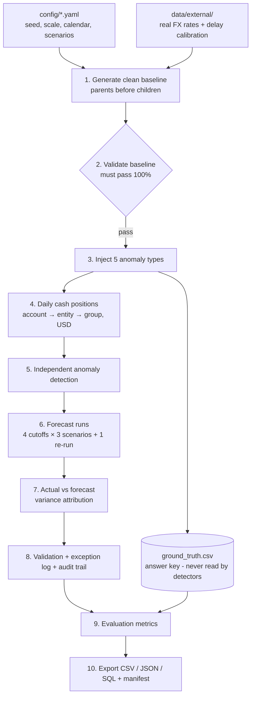
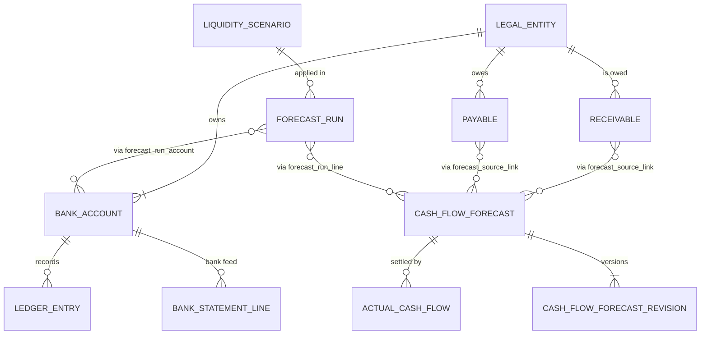

# Liquidity Forecasting and Risk Monitoring System

**A treasury pipeline for a group of companies.** It consolidates bank balances and expected cash
flows across 30 legal entities, 150 bank accounts and 5 currencies. It then forecasts short-term
liquidity under three scenarios, catches bad data before it reaches a forecast, and explains every
gap between forecast and reality, down to the source record.

Python 3.11 · pandas · NumPy · SQLite · pytest · fully deterministic (seed `20261022`) · 118 tests

---

## At a glance (full scale, verified results)

| What | Result |
|---|---|
| Data generated | 30 entities · 150 bank accounts · 100,000 ledger entries · 20,000 forecast items · 5 currencies |
| Clean-data validation | **233 / 233** checks pass (keys, joins, formats, lifecycles, revisions, reconciliation, SQL load …) |
| Bank reconciliation | Independent bank feed matched line by line: 97,599 matched, 2,364 timing differences, 304 bank-only charges, 37 in transit; **0 unexplained breaks** in 27,150 account-days of clean data |
| Anomaly detection | **85 / 85** planted problems found · **0** false alarms · **0** missed |
| Forecast accuracy (BASE scenario) | **7.1%** average error (MAPE) per account and **3.4%** for the group; 5.2% on days 1–7 rising to 11.2% on days 22–30 (all scenarios) |
| Variance explained | Every forecast-vs-actual gap split into causes; rounding residual ≤ 2 cents |
| Stress testing | STRESS lowers minimum group cash by **28–42M USD**; one entity's projected cash goes negative (CRITICAL alert) |
| Reproducibility | Two independent runs → **99 / 99** output files byte-identical (full), 101 / 101 (starter) |

---

## Contents

1. [The problem](#1-the-problem)
2. [What the system does](#2-what-the-system-does)
3. [Quick start](#3-quick-start)
4. [How it works: the pipeline](#4-how-it-works-the-pipeline)
5. [The data model](#5-the-data-model)
6. [Where the data comes from: synthetic + real](#6-where-the-data-comes-from-synthetic--real)
7. [Core logic explained](#7-core-logic-explained)
8. [Validation and evaluation](#8-validation-and-evaluation)
9. [Results](#9-results)
10. [Outputs: where to look](#10-outputs-where-to-look)
11. [Reproducibility](#11-reproducibility)
12. [Command and configuration reference](#12-command-and-configuration-reference)
13. [Project structure](#13-project-structure)
14. [Design decisions](#14-design-decisions)
15. [Assumptions and limitations](#15-assumptions-and-limitations)
16. [Requirements traceability](#16-requirements-traceability)
17. [Further documentation](#17-further-documentation)

---

## 1. The problem

A company group's treasury team has to answer three questions every day:

1. **How much cash do we have right now?** Each subsidiary holds accounts at several banks, in several currencies.
2. **How much will we have over the next few weeks?** Customers will pay invoices; suppliers, payroll, rent and tax must be paid.
3. **What if things go wrong?** Customers pay late, currencies move against us, or an unexpected bill arrives.

Getting this wrong means a subsidiary can run short of cash for payroll even while the group as a
whole has plenty. Real treasury data is also messy: bank statements disagree with the books,
exchange rates are missing, cash flows get counted twice, and "historical" forecasts sometimes use
information that wasn't available yet.

**Who uses it:** account holders (the subsidiaries), operations analysts (run forecasts, work the
exception queue), risk and compliance reviewers (approve forecasts, review flagged issues), and
system administrators (configuration, scenarios, data generation).

The full original challenge statement is in [docs/challenge_statement.md](docs/challenge_statement.md).

## 2. What the system does

| Capability | In short |
|---|---|
| **Consolidate** | Daily closing balance per account (opening + credits − debits), rolled up to entity and group level in USD using effective-dated FX rates |
| **Reconcile** | Ledger entries are matched to an independently generated bank feed; every daily difference is either explained (timing, bank charge, in transit) or reported as a break |
| **Forecast** | 30-day daily projections at four historical cutoff dates, using only information available at each cutoff |
| **Scenarios** | BASE, DELAYED_RECEIPT and STRESS, which may differ only through five documented assumptions |
| **Version** | Forecast items keep an append-only revision history; every forecast run is immutable and reads only the item versions known before its cutoff |
| **Compare** | Forecast vs actual for every run, account and day, with the gap attributed to timing, amount, unforecast items, anomalies and FX movement |
| **Detect** | Five kinds of bad data are planted, labelled in a separate answer key, and found by independent rules |
| **Decide** | Each finding gets a documented decision (auto-resolved, held for review, rejected) in an exception log |
| **Alert** | Projected breaches of each entity's minimum-cash policy |
| **Prove** | 200+ validation checks, evaluation metrics, a checksum manifest, and a two-run reproducibility test |

## 3. Quick start

**Requirements:** Python 3.11+. Tested with pandas 2.3 and 3.1 and NumPy 1.26 and 2.4; both combinations
produce byte-identical outputs.

```bash
git clone https://github.com/iashutoshyadav/liquidity-forecasting.git
cd liquidity-forecasting
pip install -r requirements.txt
pip install -e . --no-deps            # makes `python -m liqfc.cli` available
```

**Run it:**

```bash
python -m liqfc.cli all --scale starter     # small dataset, ~20-60 s
python -m liqfc.cli all --scale full        # required volumes, ~3-7 min, ~400 MB of output
pytest                                      # 118 tests, ~2-3 min
```

**Look at the results:**

| Open this | To see |
|---|---|
| `output/<scale>/reports/evaluation_report.md` | All metrics in one readable page |
| `output/<scale>/reports/validation_summary.json` | Every validation check and its result |
| `output/<scale>/dataset/input/csv/` | The generated source data (detector input) |
| `output/<scale>/dataset/derived/csv/` | Positions, forecasts, comparisons, exceptions, alerts |
| `output/<scale>/ground_truth/ground_truth.csv` | The answer key for the planted anomalies |

The `starter` scale uses exactly the same algorithms as `full`, just with smaller volumes
(5 entities, 20 accounts, 10,000 ledger entries, 2,000 forecast items).

## 4. How it works: the pipeline



| Stage | What happens | Code |
|---|---|---|
| 1. Generate | Entities → accounts → FX rates → scenarios → receivables → payables → forecast items → ledger (with derived opening balances and interest) → actual cash flows → status events → forecast-item revisions → bank feed and statements (from economic events, never from ledger rows) | `generators/` |
| 2. Validate baseline | Structural, business, volume and SQLite checks on the clean data. **The pipeline stops if anything fails.** | `validation/` |
| 3. Inject | Five kinds of controlled damage, each recorded in the ground truth with original and injected values | `anomalies/` |
| 4. Positions | Daily balances, FX conversion, consolidation, ledger ↔ bank matching and reconciliation status | `engine/balances.py`, `bank_reconciliation.py` |
| 5. Detect | Five rules scan the data without ever seeing the ground truth | `engine/anomaly_detection.py` |
| 6. Forecast | Item versions as of the cutoff, guards, scenario transformation, daily projections, run metrics, liquidity alerts | `engine/forecast_run.py`, `scenarios.py`, `liquidity_alerts.py` |
| 7. Compare | Forecast vs actual, variance broken into causes with source references | `engine/variance.py` |
| 8. Validate all | 200+ checks on inputs and outputs; failures go to the exception log | `validation/`, `pipeline.py` |
| 9. Evaluate | Accuracy, data quality, detection precision/recall, liquidity metrics | `engine/evaluation.py` |
| 10. Export | Canonical CSV/JSON, SQL schema + seed, data dictionary, manifest with SHA-256 | `exporters/` |

Each stage is a plain function of the configuration and the previous stage's output: no hidden
state, no services, no clock.

## 5. The data model

**Nine core entities**, plus supporting bridge, event and derived tables (31 tables in total: 17 input, 14 derived):



| Entity | Full volume | ID format | Notes |
|---|---|---|---|
| LegalEntity | 30 | `ENT-000001` | 7 countries, so all 5 currencies are functional somewhere |
| BankAccount | 150 | `BANKACC-ENT-000001-001` | 3–8 per entity: operating, collection, disbursement, payroll, reserve |
| LedgerEntry | 100,000 | `LED-2026-00000001` | Signed amounts; value date drives balances, `recorded_at` drives cutoff visibility |
| CashFlowForecast | 20,000 | `CF-2026-000001` | Expected flows from receivables and payables, including instalment plans |
| Receivable | ≈10,700 | `RCV-2026-000001` | Customer and intercompany invoices; lifecycle OPEN → OVERDUE → PAID / WRITTEN_OFF |
| Payable | ≈9,200 | `PAY-2026-000001` | Suppliers, payroll, rent, tax, intercompany, large one-off payments |
| CurrencyRate | 508 | `FX-2026-03-02-EUR-USD` | Business-day rates, USD per 1 unit |
| LiquidityScenario | 3 | `SCN-BASE` | Each with 5 documented assumptions (`ASM-STRESS-03` …) |
| ForecastRun | 13 | `FCAST-2026-03-01-001` | 4 cutoffs × 3 scenarios + 1 re-run that supersedes a run |

**Supporting tables:**
- **Bank-side:** the bank's transaction feed (`bank_statement_line`), daily statements built from it, and actual cash flows.
- **Versions (append-only):** `cash_flow_forecast_revision`, every value an item has ever had and when it became known.
- **Bridges (many-to-many):** `forecast_source_link`, `forecast_run_line`, `forecast_run_account`.
- **Event history (append-only):** for receivables, payables, accounts and forecast runs.
- **Derived:** positions, reconciliation items, projections, comparisons, variance drivers, alerts, exceptions, audit trail.

Every table has a primary key, typed fields, allowed values, units and foreign keys. All of these
are defined once in [`src/liqfc/core/schema.py`](src/liqfc/core/schema.py), which also generates the
[data dictionary](docs/data_dictionary.md), the SQL DDL and the validators. Cardinality, optional
relationships and lifecycles are documented in [docs/erd.md](docs/erd.md).

## 6. Where the data comes from: synthetic + real

The default is **hybrid**: a synthetic core, plus real public data where it adds realism and the licence allows it.

| Part | Source | Why |
|---|---|---|
| Entities, accounts, ledger, receivables, payables, forecasts, statements, scenarios, anomalies | **Synthetic**, generated from documented rules | No public dataset contains a company group's treasury records. Synthetic data also gives exact volumes, valid joins, perfect reconciliation and a known answer key |
| FX rates | **Real**: Kaggle `asaniczka/forex-exchange-rate-since-2004-updated-daily`, version 1091, ODC-By licence | Actual 2026 market levels and volatility instead of a random walk |
| Customer payment delays | **Calibrated** on real B2B invoices: Kaggle `sonalisingh1411/accounts-receivable-and-payment-delay-analysis`, Apache 2.0 | Realistic behaviour (e.g. a third of reliable customers pay early). In a like-for-like comparison (before cash pooling was added), it lowered BASE forecast error from 7.1% to 6.1% |

- **Offline and pinned:** the real data lives in small files in `data/external/`, built once by `scripts/prepare_external_data.py`. Runs never download anything.
- **Tracked:** each file's checksum is recorded in `data/external/SOURCES.json`, folded into the config hash, and written to every run's manifest.
- **Synthetic option:** `--data-mode synthetic` gives a fully synthetic run.
- **Evaluated:** six public datasets were assessed. Two were used and four rejected (balances that don't reconcile, a restrictive licence, and so on). Reasons are in [docs/provenance.md](docs/provenance.md).

**How synthetic values stay realistic:**
- Entity sizes are lognormal.
- Customers pay according to risk class (A, B or C), some partially or never.
- Suppliers are paid on weekly Thursday payment runs; payroll on the 25th; rent on the 1st; quarterly tax.
- Large one-off payments occur; intercompany flows are mirrored on both sides.
- Interest is calculated from actual month-end balances.

Only *inputs* are random. Every balance, status and total is **calculated** from source records,
never drawn independently.

## 7. Core logic explained

### 7.1 Money and currencies
- All amounts are **integers in minor units** (cents; yen for JPY). FX rates are integers × 10⁸. Rounding is half-even with exact integer arithmetic, so **binary floating point never touches a balance**.
- Quotation: `rate` = USD per 1 unit of the currency.
- **Effective-date rules:**
  - A business day uses its own rate.
  - A weekend or holiday uses the previous business day's rate.
  - A missing rate falls back to the last available rate, but is **flagged and held for review**. A rate of 1 is never silently substituted.
- Amounts in different currencies are **never added** without conversion; the code refuses to aggregate mixed currencies.

### 7.2 Daily cash positions
`closing(d) = opening(d) + credits(d) − debits(d)`, with `opening(d) = closing(d−1)`.

Each account's closing balance is converted to USD at the effective rate. Entities and the group are
the sum of their converted accounts.

**Independent bank reconciliation.** The bank side is a separate model, not a copy of the ledger:
- The bank feed (`bank_statement_line`) is generated from the underlying economic cash events by bank rules, and the code never reads ledger rows (a test checks this).
- 5% of customer and sundry receipts clear 1–2 business days late at the bank; a line that would clear after 30 June isn't on the statements yet.
- 4% of outgoing supplier, intercompany and one-off payments carry a wire charge (5–40 USD) that only the bank records.
- Daily statements are built from the bank lines only.

Reconciliation matches each ledger entry to one bank line (same account, exact amount, booked on the value date or up to 3 business days later) and gives every entry and line exactly one status:

| Status | Meaning | Explained? |
|---|---|---|
| MATCHED | Same amount, same day | — |
| TIMING_DIFFERENCE | Bank booked it later, within the window | yes, until the bank date |
| BANK_ONLY | Bank charge, or the bank side of a quarantined wrong-currency entry | yes |
| LEDGER_ONLY | In transit: its clearing window runs past the last statement | yes |
| UNMATCHED_BANK / UNMATCHED_LEDGER | No match and no documented reason | **no: a genuine break** |

Each account-day is RECONCILED (statement = ledger), RECONCILING_ITEM (the difference equals the explained items) or BREAK (anything else). Timing differences therefore never look like breaks, and a changed amount on either side always does.

- **Wrong-currency ledger entries** are quarantined rather than crashing the run. They're excluded from balances, forecasts and variance, never summed, and logged as CCY-001. The matching bank line is `BANK_ONLY`, so the day is a known `RECONCILING_ITEM`, not a `BREAK`.
- **Cash pooling**, as real treasuries run it. Each entity's collection and disbursement accounts in its home currency are swept weekly (last business day) back to a small target balance. Surplus moves up to the operating account, and shortfalls are topped up from it, as paired `INTERNAL_TRANSFER` entries. Paying accounts are therefore no longer pre-funded for months, and receipts don't pile up in collection accounts. Forecasts project the same sweeps with the same rule.

### 7.3 Forecasting with a strict cutoff
A forecast "as of" a cutoff date may only use information recorded **before** that moment:
- **Opening balance** = account opening + ledger entries recorded before the cutoff. A payment value-dated earlier but posted after the cutoff is excluded.
- **Forecast items** must have been known before the cutoff, and not yet cancelled or written off. Partially paid items keep only the unpaid remainder.
- **Item versions:** each item is read at its **latest revision known strictly before the cutoff** (see 7.3.1), and the run line records which revision it used.
- **Overdue items** are re-dated by documented rules: receivables to cutoff + 7 days, payables to the cutoff.
- **Guards** exclude lines that would leak future information, mix currencies, or double count a source. Each exclusion is logged with a reason.
- **Projection:** daily closing per account for 30 days, converted at the last rate published before the cutoff, then consolidated. Run metrics include minimum cash and its date, days below threshold, negative-balance days, and expected inflows and outflows.

Runs are **immutable versions** (`FCAST-<cutoff>-<seq>`). Each records:
- the scenario;
- the cutoff and generation timestamps;
- the horizon;
- hashes of the inputs and the config;
- the calculation version;
- its status history: DRAFT → EXECUTED → APPROVED → SUPERSEDED.

### 7.3.1 Revision history: why the past can't be rewritten
Forecast items change: a customer promises a new payment date, an estimate is redone. Overwriting the item would let a later
change leak into a re-run of an earlier forecast. Instead, every change is appended to `cash_flow_forecast_revision`:

- Revision 1 holds the original values, known at the item's `known_at`. Revision numbers are contiguous and `known_at` strictly increases.
- About 6% of single-instalment customer receipts get a CUSTOMER_PROMISE revision, recorded after the item and before any settlement.
- The item row always equals its latest revision (checked by validation `BUS-REV`).
- A run with cutoff *c* uses `items_as_of(c)`: for each item, the latest revision with `known_at < c`. Items with no such revision aren't visible.

Look-ahead detection works on the history, not just the current row:
- **CUT-001:** an item or any of its revisions is based on an actual recorded at or after that version became known (one finding per item). Planted leakage is a back-dated revision copied from the item's own future settlement.
- **CUT-003:** the current values match none of the recorded revisions (an untracked overwrite that can't be dated); held for review.
- A legitimate promise revision recorded before payment is **not** flagged, even when it turns out accurate.

Tests in `tests/test_revision_history.py` show that appending a later revision leaves every earlier run's lines byte-identical.

### 7.4 Scenarios
The only permitted differences between scenarios are these five assumptions:

| Assumption | BASE | DELAYED_RECEIPT | STRESS |
|---|---|---|---|
| Share of customer receipts delayed | 0% | 30% | 40% |
| Delay | — | 14 days | 21 days |
| Collection haircut | — | — | 10% |
| FX shock on non-USD balances | — | — | EUR/GBP −5%, INR −8%, JPY −6% |
| Unplanned one-off payment | — | — | 8M USD (ENT-000001, cutoff + 7 days) |

Which receipts get delayed is decided by a stable hash of the item ID, so the selection is
reproducible and independent of row order. Every changed line records the assumption IDs that
changed it. A test re-derives every scenario line from BASE independently ([docs/scenarios.md](docs/scenarios.md)).

### 7.5 Explaining forecast vs actual
For each run, account and day: `variance = actual closing − forecast closing`, split into causes:

| Cause | Meaning | Example |
|---|---|---|
| **TIMING** | The flow happened, but on a different day | Invoice forecast for the 10th, paid on the 15th |
| **AMOUNT** | The flow happened, with a different amount | Payroll forecast at last month's figure; actual 1.5% higher |
| **UNFORECAST** | Cash moved with no forecast item | Bank fees, interest, small sundry payments, invoices raised after the cutoff |
| **ANOMALY** | The flow belongs to an item excluded as bad data | Settlement of a forecast item that leaked future information |
| **FX_MOVEMENT** | The USD value changed because the rate moved | EUR balance worth more at today's rate than at the cutoff rate |
| **RESIDUAL** | Rounding only | At most 2 cents in practice |

The causes **add up exactly** to the total variance. Each cause row points to its source: the forecast
item, the ledger entry, or the account and day for grouped small flows (`variance_attribution`).

### 7.6 Anomalies: planted, labelled, detected
Anomalies are injected **only after the clean data has passed validation**. Each change is recorded
in the ground-truth file, which the detectors never see.

| Anomaly | How it's planted | How it's detected | Decision |
|---|---|---|---|
| Balance mismatch | Bank statement closing balance shifted | Statement − ledger differs from the explained reconciliation items | Held for review |
| Missing FX rate | A business-day rate deleted | Every currency needs a rate for every business day | Held for review (flagged fallback used) |
| Cash flow counted twice | Forecast item duplicated for the same invoice | A second item for the same invoice instalment, or total allocation for one source > 100%, with or without a source link | Auto-resolved (copy excluded from every run; HIGH severity if it has no source link) |
| Forecast uses future actual | Back-dated revision copied from the item's own later payment | Basis record recorded after the item, or the revision, was known | Rejected (excluded from runs) |
| Currency mixed without conversion | Item restated in another currency on its account | Item currency ≠ account currency | Rejected (excluded from runs) |

Legitimate look-alikes are deliberately included and must **not** be flagged:
- two genuine invoices with the same amount and date;
- instalment plans (one invoice, two forecast items at 50% each);
- payroll estimated from last month's actual.

Details are in [docs/anomaly_catalog.md](docs/anomaly_catalog.md).

### 7.7 Decisions, history and audit
- **Exception log:** every finding with its rule, record, severity, observed and expected values, decision and resolution status.
- **Event tables:** every status change (invoices, bills, accounts, forecast runs) is appended, never overwritten. Lifecycle transitions are validated: for example, an invoice can't jump from OPEN to WRITTEN_OFF without becoming OVERDUE first.
- **Run approval (RUN-01):** a run stays EXECUTED (pending review) instead of APPROVED only when its own inputs are affected. Either one of its accounts used a fallback FX rate at the cutoff, or it has an unexplained statement break of at least 1,000 USD in the 7 days before the cutoff. Both settings are configurable. Each hold reason is written to the audit trail, so a January break no longer blocks a June forecast.

## 8. Validation and evaluation

**Validation** runs at three points: the clean baseline before injection, the clean baseline with all outputs, and the injected dataset with all outputs.

| Type | Checks |
|---|---|
| Structural | Primary-key uniqueness, foreign keys (incl. polymorphic and a SQLite `foreign_key_check`), ID formats, allowed values, required fields, uniqueness, date order, lifecycle transitions |
| Business | Statement = bank lines, revision history (contiguous, increasing `known_at`, current = latest, basis known before revision), statement arithmetic and continuity, FX coverage, currency consistency, duplicate sources and duplicate items, source-link completeness, cutoff compliance, actual = ledger, sign conventions, intercompany mirroring, no activity on dormant accounts, exact volumes |
| Outputs | Position consistency (account → entity → group), reconciliation items (every ledger entry and bank line exactly once, differences explained), forecast cutoff compliance incl. revision known before cutoff, scenario = documented transformation, variance reconciliation, forecast history preserved |

**Evaluation** (all computed from outputs; nothing hard-coded):
- **Forecast accuracy:** MAE, RMSE, bias and MAPE, by scenario and by horizon. Only matching run/account/date rows are used; zero denominators and missing actuals are handled as documented.
- **Data quality:** key uniqueness, foreign-key pass rate, reconciliation rate, FX coverage, validation pass rate.
- **Detection:** true and false positives, false negatives, precision, recall and F1 per anomaly type, compared against the ground truth.
- **Liquidity:** minimum projected cash, first breach date, base-vs-stress difference.

## 9. Results

Full scale, seed `20261022`, hybrid data. Reproduce with `python -m liqfc.cli all --scale full`.

**Validation**

| Stage | Passed | Failed |
|---|---|---|
| Clean baseline before injection | 141 | 0 |
| Clean baseline + all outputs | 233 | 0 |
| Injected dataset + all outputs | 223 | 9 (exactly the 5 planted anomaly types; balance mismatches, duplicates and cutoff leakage each trip related checks) |

**Anomaly detection**

| Type | Planted | Found | False alarms | Missed |
|---|---|---|---|---|
| Balance mismatch | 25 | 25 | 0 | 0 |
| Missing FX rate | 10 | 10 | 0 | 0 |
| Cash flow counted twice | 20 | 20 | 0 | 0 |
| Forecast uses future actual | 15 | 15 | 0 | 0 |
| Currency mixed | 15 | 15 | 0 | 0 |
| **Total** | **85** | **85** | **0** | **0** |

On the clean data, the detectors raise nothing (0 false alarms).

**Forecast accuracy** (account level, USD, 54,000 matched rows, clean data)

| Slice | MAE (USD) | MAPE | Bias (USD) |
|---|---|---|---|
| BASE | 112,734 | 7.1% | +82,851 |
| DELAYED_RECEIPT | 95,289 | 6.7% | +14,918 |
| STRESS | 239,535 | 11.2% | −194,971 (deliberately pessimistic) |
| Days 1–7 | | 5.2% | |
| Days 22–30 | | 11.2% | |
| Group level, BASE | | 3.4% | |

Cash pooling cut the average error in USD by about 46% when it was introduced, from MAE 277,640 to 149,939 across all
scenarios (149,186 now). Percentage error rose, from 7.6% to 8.4% overall, because pooled accounts now hold much
smaller balances, so the same error is a larger share, and because weekly sweeps add account-level
movement.

**Data quality:** key uniqueness, foreign-key pass rate and FX coverage are **100%** on clean data, and no
account-day is a break (16,229 reconciled, 10,921 explained by reconciling items). On the injected data they drop by
exactly the planted damage: 25 statement breaks and 288 conversions on a fallback rate.

**Bank reconciliation items** (full scale): 97,599 MATCHED, 2,364 TIMING_DIFFERENCE, 304 BANK_ONLY, 37 LEDGER_ONLY
(in transit at 30 June), 0 UNMATCHED. Every ledger entry and bank line appears in exactly one item. In the injected data, 9 of 12 forecast runs are
held for review: April for a missing pre-cutoff FX rate, May and June for material breaks in the
week before the cutoff. The 3 March runs are approved.

**Liquidity:** with cash pooling, minimum projected group cash is 8.4–11.2× the group policy minimum
(326–437M USD against a 38.9M threshold), down from about 14× before pooling. At every cutoff,
STRESS lowers minimum group cash by 28–42M USD against BASE. In all four STRESS runs, ENT-000001's
projected cash goes negative (CRITICAL alert).

**Transaction mix:** sundry receipts and payments are 77% of ledger rows, which is realistic for
small-ticket activity and fixed by the 100,000-row target, but only 19% of money moved. Their net
drift is +4.5%, and activity is higher on Mondays, Fridays and at month-end. 60 accounts are
cash-pooled, producing 3,120 sweep entries.

## 10. Outputs: where to look

```
output/<scale>/
├── dataset/                 the published dataset (with planted anomalies)
│   ├── input/csv, json      17 source tables (what the detectors see)
│   ├── derived/csv, json    positions, forecasts, comparisons, variance, alerts, exceptions, audit
│   └── sql/                 schema.sql (PK / FK / CHECK constraints) + seed.sql
├── baseline/                the clean dataset and its outputs (CSV), for comparison
├── ground_truth/            ground_truth.csv / .json: the answer key
├── reports/
│   ├── evaluation_report.md       readable summary of every metric
│   ├── evaluation_summary.json    the same, machine-readable
│   ├── validation_summary.json    every check, per stage
│   ├── reproducibility_report.*   two-run comparison (after `reproduce`)
│   └── data_dictionary.md
└── manifest.json            every file: rows, bytes, SHA-256; seed, scale, config hash, command, data sources
```

Good tables to start with:
- `forecast_run.csv`: one row per forecast version with its key metrics.
- `forecast_comparison.csv`: forecast vs actual with the variance split.
- `exception_log.csv`: every finding and decision.
- `liquidity_alert.csv`: policy breaches.

## 11. Reproducibility

```bash
python -m liqfc.cli reproduce --scale starter     # ~1-2 min
python scripts/reproduce.py --scale full          # ~7-13 min
```

This runs the whole pipeline twice into separate temporary folders and compares row counts, SHA-256
checksums, raw bytes and validation summaries. Verified results:

| Run | Result |
|---|---|
| Full, hybrid (current) | 99 / 99 files identical |
| Starter, hybrid (current) | 101 / 101 files identical |
| Full, synthetic (earlier version, before revisions and the bank model) | 91 / 91 files identical |
| Fresh clone: pandas 2.3.3 + NumPy 1.26.4 vs pandas 3.1.0 + NumPy 2.4.6 (starter, earlier version) | 92 / 92 files identical |

How determinism is achieved:
- one named random stream per module, so changing one generator doesn't shift the others;
- a fixed generation timestamp instead of the clock;
- IDs assigned after a stable sort;
- canonical CSV/JSON output: fixed column order, UTF-8, LF line endings, fixed number formats;
- pinned external files.

## 12. Command and configuration reference

**Commands** (`python -m liqfc.cli <command>`; earlier stages run automatically):

| Command | Does |
|---|---|
| `generate` | Generate + validate the clean baseline, inject anomalies, export data, SQL and ground truth |
| `forecast` | + positions, detection, forecast runs, comparisons, alerts |
| `validate` | + full validation, exception log, audit trail |
| `all` / `export` | + evaluation metrics and manifest (`--with-reproduce` adds the two-run test) |
| `reproduce` | Two complete runs and a checksum comparison |
| `docs` | Regenerate `docs/data_dictionary.md` from the schema |

**Options:**
- `--scale starter|full`
- `--seed N` (default 20261022)
- `--data-mode hybrid|synthetic`
- `--output DIR`
- `--config-dir DIR`

`make` shortcuts exist in the [Makefile](Makefile).

**Configuration** (`config/`):

| File | Controls |
|---|---|
| `default.yaml` | Seed, reporting currency, currencies and minor units, external data switches, calendar, FX behaviour, generation distributions, forecast cutoffs and horizon, liquidity policy, export formats, evaluation settings |
| `scales.yaml` | Volumes for `starter` and `full` |
| `scenarios.yaml` | The five assumptions for each scenario |
| `anomalies.yaml` | How many of each anomaly to plant |

**Rebuilding the real-data files** (only needed to change source versions): download the two
datasets with `kagglehub`, then run
`python scripts/prepare_external_data.py --fx-csv <daily_forex_rates.csv> --ar-csv <Dataset.csv>`.

## 13. Project structure

```
liquidity-forecasting/
├── config/            default.yaml · scales.yaml · scenarios.yaml · anomalies.yaml
├── data/external/     pinned real FX rates · delay calibration · SOURCES.json (provenance)
├── src/liqfc/
│   ├── cli.py, pipeline.py     command line and stage orchestration
│   ├── core/          config, deterministic RNG, IDs, schema, enums, money, calendar, dataset
│   ├── generators/    entities, accounts, fx_rates, receivables, payables, forecast_items,
│   │                  ledger, actual_cash_flows, balance_statements
│   ├── engine/        fx_conversion, balances, bank_reconciliation, scenarios, forecast_run,
│   │                  approval, variance, anomaly_detection, liquidity_alerts, evaluation
│   ├── anomalies/     injectors, ground_truth
│   ├── validation/    checks, foreign_keys, lifecycle, reconciliation, reproducibility, report
│   ├── audit/         append-only event logs, run lifecycle, history replay
│   └── exporters/     canonical CSV/JSON, SQL seed, data dictionary, manifest
├── scripts/           reproduce.py · prepare_external_data.py
├── docs/              architecture · data_dictionary · erd · business_rules · scenarios ·
│                      anomaly_catalog · provenance
└── tests/             18 test modules, 118 tests
```

## 14. Design decisions

| Decision | Why |
|---|---|
| Integer minor units instead of floats | Reconciliation must be exact; `0.1 + 0.2 ≠ 0.3` in floating point |
| One schema module drives docs, SQL and validation | They can never drift apart |
| Ground truth kept outside the dataset | Detection must be honest; a test checks the detector code never references it |
| Detection rules double as forecast guards | The same logic that flags bad data keeps it out of forecasts |
| Append-only events, item revisions and versioned runs | History must be auditable; a later change can't alter an earlier forecast |
| Bank feed generated from economic events, not ledger rows | Reconciliation only means something if the two sides can disagree |
| Opening balance excludes entries posted after cutoff | Prevents "hindsight" leaking into historical forecasts |
| Hash-based scenario selection | Scenario differences are reproducible and explainable per item |
| Synthetic core + pinned real data | Structure and answer key where they matter; realism where it's cheap and lawful |
| No web framework, services or ML | The problem is data correctness and traceability; extra moving parts add risk, not value |

## 15. Assumptions and limitations

**Assumptions** (all configurable):
- **Dates:** data covers 2026-01-01 to 2026-06-30. Forecast cutoffs are the 1st of March, April, May and June, with a 30-day horizon, so every forecast can be compared with actuals.
- **Currency:** USD is the reporting currency.
- **Calendar:** one global business calendar (Mon–Fri plus 3 holidays).
- **Opening balances** are calibrated so the clean data never goes negative. Collection and disbursement accounts in each entity's home currency are cash-pooled weekly; payroll, reserve and foreign-currency accounts are not pooled.
- **Customers:** class C and write-off rates are not in the real calibration data, so they remain documented stress assumptions.
- **Run approval** follows a documented reviewer policy; there is no approval UI.
- **JSON size limit:** derived tables over 100,000 rows are exported as CSV only, to limit size.

**Limitations:**
- About 77% of ledger rows (19% of value) are small sundry payments. They have no forecast items, so UNFORECAST is still the largest variance category at the horizon end. A run-rate model for small flows would reduce it; it isn't implemented.
- The group still holds 8–11× its policy minimum (payroll, reserve and foreign-currency accounts aren't pooled), so breaches appear at entity level under STRESS, not at group level.
- Account-level percentage error rose after cash pooling (smaller balances, weekly sweeps), although the error in USD fell.
- Detectors are rules written for the five specified anomaly types. Perfect scores show they work on those types, not that they generalise to unseen kinds of bad data.
- Byte-identical output was verified on Python 3.11 with pandas 2.3/NumPy 1.26 and pandas 3.1/NumPy 2.4 (versions are recorded in each manifest). Library versions outside the tested range in `requirements.txt` could change random draws.
- The bank model and the ledger start from the same economic events by design, so the bank side differs only through the documented bank rules (clearing delays, charges). It doesn't model bank errors, reversals or many-to-one netting, and matching requires an exact amount.
- CUT-003 (untracked overwrite) has no planted anomaly, so its precision and recall aren't measured; it's covered by unit tests only.
- The Kaggle FX source doesn't name its upstream provider, so treat the rates as realistic market levels, not official fixings.
- No dashboard; the problem statement made it optional. The outputs are structured to feed one.

## 16. Requirements traceability

| Problem-statement requirement | Where it's met |
|---|---|
| Data dictionary for the 9 entities (type, required, values, units, uniqueness, rules) | `core/schema.py` → [docs/data_dictionary.md](docs/data_dictionary.md) |
| Parents before children; valid parent IDs | `pipeline.generate_baseline`; FK checks incl. SQLite |
| Deterministic IDs (ENT-, BANKACC-, LED-, CF-, FCAST-) | `core/ids.py`; format checks |
| Volumes: 30 / 150 / 100,000 / 20,000 / 5 currencies, fixed seed, scalable | `config/scales.yaml`; volume check `BUS-VOL` |
| Delayed receivables, FX movement, large one-offs | `generators/receivables.py`, `fx_rates.py`, `payables.py` |
| Five labelled edge cases | `anomalies/injectors.py`; [docs/anomaly_catalog.md](docs/anomaly_catalog.md) |
| Derived values calculated, not random | balances, statuses, interest, positions; rules in [docs/business_rules.md](docs/business_rules.md) |
| Separate ground truth, never leaked | `output/*/ground_truth/`; isolation test |
| Validation: PK, FK, enums, dates, arithmetic, lifecycles, duplicates | `validation/` → `validation_summary.json` |
| CSV / JSON / SQL + README, dictionary, command, seed, manifest, validation summary | `exporters/`; `output/*/` |
| Regenerate twice, compare counts and checksums | `reproduce` → `reproducibility_report.md` |
| Daily balances reconcile | Independent bank feed; 0 unexplained breaks on clean data; every difference itemised in `bank_reconciliation_item` |
| Scenarios differ only by documented assumptions | `scenario_assumption`; check `BUS-SCN`; scenario tests |
| Forecasts reproducible; history preserved | Versioned runs, input/config hashes, supersede events |
| Actual-vs-forecast variance explainable | `forecast_comparison` + `variance_attribution` |
| Lawful provenance | [docs/provenance.md](docs/provenance.md); manifest `data_provenance` |

## 17. Further documentation

| Document | Covers |
|---|---|
| [docs/architecture.md](docs/architecture.md) | Pipeline, module responsibilities, design decisions, output layout |
| [docs/data_dictionary.md](docs/data_dictionary.md) | Every table and field (generated from the schema) |
| [docs/erd.md](docs/erd.md) | Relationships, cardinality, effective dates, lifecycle states |
| [docs/business_rules.md](docs/business_rules.md) | Every rule with its ID: money, FX, generation, forecasting, variance, decisions |
| [docs/scenarios.md](docs/scenarios.md) | Scenario assumptions and the exact transformation |
| [docs/anomaly_catalog.md](docs/anomaly_catalog.md) | Each anomaly: injection, detection, decision, boundary cases |
| [docs/provenance.md](docs/provenance.md) | Data sources, licences, transformations, rejected datasets |
