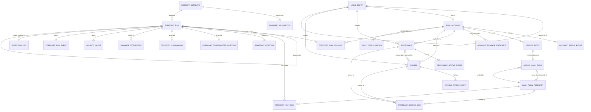

# Entity-relationship model

`CURRENCY_RATE` has no foreign keys. Rows are looked up by `(base_currency, rate_date)`
following the effective-date rules (FX-*), so a missing rate is a detectable gap and never an
orphaned reference.

## Cardinality and optionality

| Relationship | Cardinality | Optional | Notes |
|---|---|---|---|
| LegalEntity → LegalEntity (parent) | N:1 | yes (group parent has none) | `parent_entity_id` |
| LegalEntity → BankAccount | 1:N (3–8) | no | every entity has OPERATING, COLLECTION, DISBURSEMENT |
| BankAccount → LedgerEntry | 1:N | dormant accounts stop after dormancy | currency must equal account currency |
| BankAccount → AccountBalanceStatement | 1:N (one per calendar day) | no | unique (account_id, statement_date) |
| Receivable / Payable → BankAccount, LegalEntity | N:1 | no | account must belong to the same entity |
| Receivable ↔ Payable (intercompany) | 1:1 | yes | `payable.ic_receivable_id`; equal amount, currency and date |
| Receivable/Payable ↔ CashFlowForecast | **N:M** via `forecast_source_link` | no | instalments: 1 source → 2 items at 5,000 bp each; allocation per source ≤ 10,000 bp |
| CashFlowForecast → ActualCashFlow | 1:N | yes (open items) | partial payments give 2 actuals |
| LedgerEntry → ActualCashFlow | 1:0..1 | yes | only settlement entries |
| ActualCashFlow → CashFlowForecast (basis) | 1:N | yes | payroll estimate = previous month's actual |
| LiquidityScenario → ScenarioAssumption | 1:N (5) | no | the only allowed scenario differences |
| LiquidityScenario → ForecastRun | 1:N | no | |
| ForecastRun → ForecastRun (supersedes) | 1:0..1 | yes | re-runs |
| ForecastRun ↔ BankAccount | **N:M** via `forecast_run_account` | no | opening balance and FX basis per run |
| ForecastRun ↔ CashFlowForecast | **N:M** via `forecast_run_line` | yes (scenario-only lines have no cf_id) | adjusted date, amount and status per run |
| *Polymorphic* `source_type/source_id` | N:1 | depends | validated against receivable or payable by type |

## Effective dates

* `legal_entity.effective_from/to`; `bank_account.opened_date`; dormancy in `account_status_event`.
* `currency_rate.rate_date` is valid for that business day and carries forward to the following non-business days.
* `liquidity_scenario.effective_from` and `version`.
* `cash_flow_forecast.known_at`, `ledger_entry.recorded_at` and `actual_cash_flow.recorded_at` drive cutoff visibility.

## Lifecycle states (validated by `validation/lifecycle.py`)

| Entity | Transitions |
|---|---|
| Receivable | ∅→OPEN; OPEN→PARTIALLY_PAID / PAID / OVERDUE; OVERDUE→PARTIALLY_PAID / PAID / WRITTEN_OFF; PARTIALLY_PAID→PAID |
| Payable | ∅→SCHEDULED; SCHEDULED→APPROVED / CANCELLED; APPROVED→PAID / CANCELLED |
| ForecastRun | ∅→DRAFT→EXECUTED; EXECUTED→APPROVED / REJECTED / SUPERSEDED; APPROVED→SUPERSEDED |
| BankAccount | ∅→ACTIVE; ACTIVE→DORMANT / CLOSED; DORMANT→ACTIVE / CLOSED |
| CashFlowForecast (derived status) | OPEN, PARTIALLY_SETTLED, SETTLED, CANCELLED, WRITTEN_OFF (derived from settlements and source status) |

Each entity's `status` column must equal its last event. This is checked by the `STR-LIFE-*` checks.
